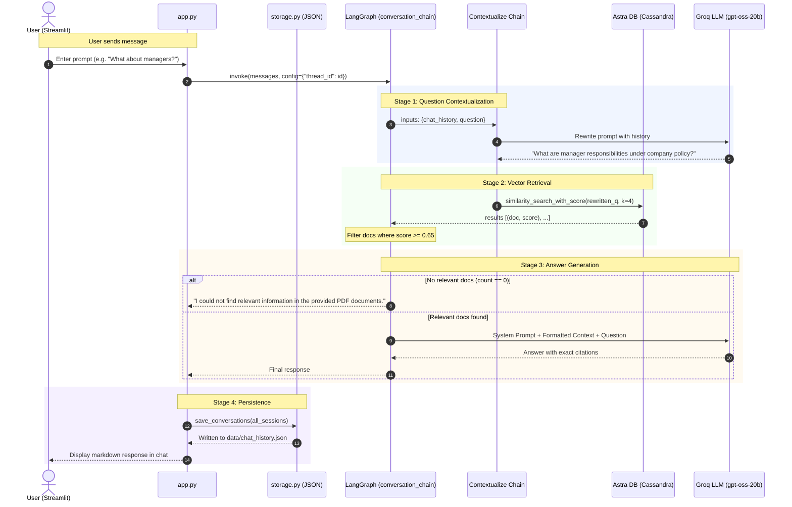

# 📖 PDF RAG Chatbot — Technical Documentation

Comprehensive architectural and engineering guide for the **Conversational PDF RAG Chatbot**.

---

## 1. System Overview

The system is designed to provide strict, verifiable, and conversational question-answering over organizational documents (such as Company Policies, Standard Operating Procedures, and Operations Manuals).

### Core Design Principles:
1. **Zero Hallucination Tolerance:** The system strictly refuses to answer questions not present in the indexed PDF corpus.
2. **Exact Citations:** Every factual answer cites the source filename and human-readable page number.
3. **Multi-Turn Context Awareness:** Ambiguous or elliptical follow-up questions (e.g., *"What about managers?"*) are autonomously rewritten to incorporate chat history before vector search.
4. **Session Resilience:** All conversations and memory states persist across browser refreshes and application restarts.

---

## 2. End-to-End Architecture & Sequence Flow



---

## 3. Data Ingestion Pipeline (`src/rag_chatbot/data_ingestion/`)

The ingestion pipeline converts raw PDF files from the `documents/` directory into vector embeddings stored in DataStax Astra DB.

### 3.1 PDF Loading (`pdf_loader.py`)
- **Loader:** Uses `PyPDFLoader` from `langchain_community.document_loaders`.
- **Page Number Normalization:** `PyPDFLoader` assigns 0-based index numbers (`0, 1, 2...`). The loader automatically increments this:
  ```python
  if "page" in page.metadata and isinstance(page.metadata["page"], (int, float)):
      page.metadata["page"] = int(page.metadata["page"]) + 1
  ```
  This guarantees that cited page numbers match the physical page numbers printed on the PDF.
- **Fault-Tolerant Iteration:** Individual PDF loads are isolated with `try...except`. A corrupted PDF file will log an error without aborting ingestion for other files.

### 3.2 Text Chunking (`text_splitter.py`)
- **Splitter:** `RecursiveCharacterTextSplitter`.
- **Configuration:**
  - `chunk_size = 1000`: Optimal for preserving semantic cohesion within policy sections.
  - `chunk_overlap = 200`: Ensures no context is lost across chunk boundaries.
  - `separators = ["\n\n", "\n", " ", ""]`: Splits on logical paragraphs and line breaks first.

### 3.3 Embeddings (`embeddings.py`)
- **Model:** `sentence-transformers/all-MiniLM-L6-v2` via `langchain_huggingface.HuggingFaceEmbeddings`.
- **Embedding Dimension:** 384 dimensions.
- **Characteristics:** Runs locally, lightweight, fast, and does not consume external API quotas.

---

## 4. Vector Storage & Retrieval (`src/rag_chatbot/database/` & `retrieval/`)

### 4.1 Cassandra / Astra DB Client (`cassandra_client.py`)
- Connected using DataStax **CassIO**:
  ```python
  cassio.init(token=application_token, database_id=database_id, keyspace=keyspace)
  ```
- Environment variables required:
  - `ASTRA_DB_APPLICATION_TOKEN`: Authentication token generated from DataStax Astra console.
  - `ASTRA_DB_ID`: Database UUID identifier.
  - `ASTRA_DB_KEYSPACE`: Keyspace name (default: `default_keyspace`).

### 4.2 Vector Store Abstraction (`vector_store.py`)
- Uses LangChain's `Cassandra` vector store wrapper.
- **Table Name:** `pdf_rag_documents`.
- **Batch Insertion:** `store_documents(chunks)` adds chunks in batches, creating the vector index and mapping metadata (`source`, `page`, etc.).

### 4.3 Similarity Search & Threshold Filtering (`retriever.py`)
- Standard similarity searches often return distant chunks even when a query is completely out-of-scope.
- **Thresholding Solution:**
  ```python
  SIMILARITY_THRESHOLD = 0.65
  ```
  The retriever requests the top `k=4` chunks using `similarity_search_with_score(query, k=k)`. It discards any document whose similarity score falls below `0.65`. If no chunks exceed `0.65`, an empty list is returned, triggering the fallback refusal branch.

---

## 5. Conversational Chains & LangGraph Workflow (`src/rag_chatbot/chains/`)

### 5.1 Standalone Contextualizer (`contextualize_chain.py`)
When a conversation spans multiple turns, user questions frequently use pronouns or incomplete phrases (e.g., *"What about managers?"*, *"Why is that required?"*).
- **Prompt:** Instructs the LLM to inspect conversation history and reformulate the prompt into a standalone query without answering it.
- **LLM:** Groq ChatGroq (`openai/gpt-oss-20b`), `temperature=0` for maximum determinism.

### 5.2 RAG Runnable Assembly (`rag_chain.py`)
The RAG pipeline is assembled using LangChain Expression Language (LCEL):
1. **Contextualization Step:** Rewrites question using chat history. Falls back to original query if rewriting fails.
2. **Retrieval Step:** Retrieves relevant chunks above score threshold.
3. **Document Formatting:** Formats retrieved chunks with metadata and sanitizes page numbers:
   ```python
   def clean_page_number(page):
       try:
           return str(int(float(page)))
       except (ValueError, TypeError):
           return str(page)
   ```
   *Fixes Astra DB float serialization quirk where `12.0` would otherwise be passed into prompt context.*
4. **Conditional Branching (`RunnableBranch`):**
   - If `len(documents) == 0`: Outputs `"I could not find relevant information in the provided PDF documents."`
   - Otherwise: Passes formatted context to prompt and LLM.

### 5.3 LangGraph StateGraph (`conversation_chain.py`)
Conversations are executed as a compiled LangGraph workflow:
- **State Schema:** `MessagesState` (stores conversation messages between Human and AI).
- **Node:** `generate_answer` extracts the latest message, supplies prior messages as `chat_history`, invokes the RAG chain, and returns an `AIMessage`.
- **Checkpointer:** `InMemorySaver` caches execution checkpoints per `thread_id`.

---

## 6. Persistence & Session Management (`src/rag_chatbot/utils/storage.py`)

### 6.1 The Refresh Problem
Streamlit resets `st.session_state` on every browser reload. To eliminate amnesia:
- Conversations and their complete message history are persisted to `data/chat_history.json`.

### 6.2 Data Schema (`chat_history.json`)
```json
{
  "thread_uuid_1": {
    "title": "Employee Responsibilities",
    "messages": [
      { "role": "user", "content": "What are employee responsibilities?" },
      { "role": "assistant", "content": "Employees must read applicable policies..." }
    ]
  }
}
```

### 6.3 LangGraph Checkpointer Synchronization
When an app reloads, LangGraph's RAM checkpointer is empty even if messages are displayed in Streamlit.
- **`sync_langgraph_state(conversation_chain, thread_id, messages)`**:
  Inspects the checkpointer for `thread_id`. If empty, it transforms stored JSON messages into `HumanMessage` and `AIMessage` objects and updates the checkpointer state via:
  ```python
  conversation_chain.update_state(config, {"messages": langchain_messages})
  ```
  This guarantees that conversational context works seamlessly after page refreshes.

---

## 7. Streamlit UI Architecture (`app.py`)

### Lifecycle Execution Flow:
1. **Resource Caching:** `get_conversation_chain()` decorated with `@st.cache_resource` ensures backend chains and models are compiled only once across sessions.
2. **State Hydration:**
   - Reads `chat_history.json` on startup via `load_conversations()`.
   - Restores the most recent active `thread_id`.
   - Hydrates `st.session_state.messages` and synchronizes LangGraph memory.
3. **Sidebar Controls:**
   - **`➕ New Chat`:** Generates a new `thread_id` UUID, resets the message list, and saves state.
   - **Thread Switcher:** Lists saved threads. Highlights the active thread (`👉 Title`). Clicking any thread swaps `thread_id`, reloads its messages, syncs memory, and reruns the script.
   - **`🗑️ Clear All Chats`:** Wipes history on disk and reinitializes a fresh session.
4. **Execution & Auto-Save:**
   - On the first question in a session, generates a 35-character truncated title from user query.
   - Streams spinner while generating response.
   - Appends user and assistant messages to state and commits to `data/chat_history.json`.

---

## 8. Troubleshooting & Common Issues

| Issue | Root Cause | Solution |
| :--- | :--- | :--- |
| **`ConnectionError: Failed to connect to Astra DB`** | Missing or incorrect Astra DB credentials in `.env` | Verify `ASTRA_DB_APPLICATION_TOKEN`, `ASTRA_DB_ID`, and `ASTRA_DB_KEYSPACE`. Ensure DB is in *Active* status. |
| **`ValueError: GROQ_API_KEY is missing`** | `.env` file does not define `GROQ_API_KEY` | Add valid Groq API key starting with `gsk_` to `.env`. |
| **Chat history missing on reload** | Write permissions on `data/` or corrupted JSON | Check `data/chat_history.json` permissions or delete it to let the app regenerate it. |
| **`FileNotFoundError: Documents directory not found`** | `documents/` folder does not exist or has no PDFs | Create `documents/` at project root and place at least one `.pdf` file inside. |
| **Output shows `Page: 12.0`** | Unsanitized metadata float from Astra DB | Solved by `clean_page_number` in `rag_chain.py`. |
